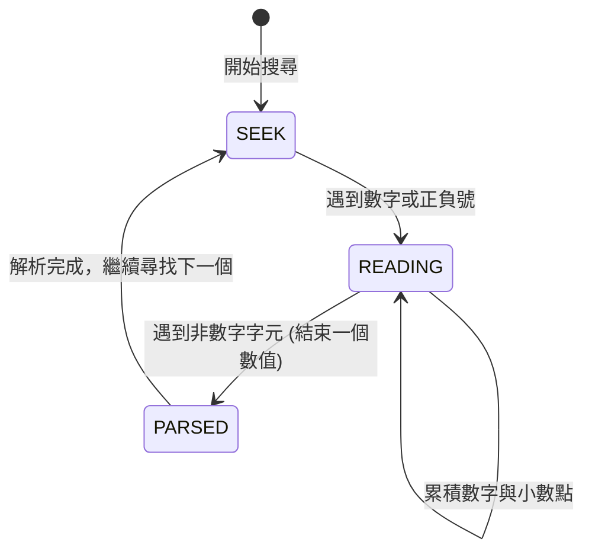

# C 語言底層 I/O 深度極限解析：scanf、getchar、char[] 與 printf

> 本指南專注於深入解析 **`scanf` 所有修飾符語法機制**、**`getchar` 狀態機/複雜字元流解析**、**字元陣列記憶體與指標底層** 以及 **`printf` 內部格式化引擎**。  
> 包含針對複雜結構化字串、雜訊混雜文字中精準萃取特定數字/欄位的工業級與競賽實戰寫法。

---

## 目錄
1. [`scanf` 格式控制完整語法規範與底層解析](#1-scanf-格式控制完整語法規範與底層解析)
   - 完整語法骨架 `%[*][width][length]specifier`
   - 抑制賦值修飾符 `*` (Assignment-suppression)
   - 最大欄位寬度 `width`
   - 長度修飾符 `length` (hh, h, l, ll, z, t, L)
   - 掃描集 (Scan Set) `%[...]` 與反向集合 `%[^...]`
   - 特殊計數字元 `%n` 追蹤讀取進度
   - 常見非空白字元比對與強制分隔機制
2. [`getchar` 處理複雜輸入流與狀態機解析](#2-getchar-處理複雜輸入流與狀態機解析)
   - 為什麼需要以字元流思考：stdin 緩衝區行為
   - 範例 A：結構化括號與逗號格式（如三維向量/座標）的精確解析
   - 範例 B：從大量雜訊字串中過濾並萃取浮點數（有限狀態機 FSM）
   - 範例 C：高效逐字元整數/小數自製解析器（Fast I/O 實作）
3. [字元陣列 (`char[]`) 與指標的記憶體模型與硬核細節](#3-字元陣列-char-與指標的記憶體模型與硬核細節)
   - 記憶體佈局：Stack、Data Segment 與 `.rodata`
   - 陣列退化 (Array Decay) 的底層真相
   - 二維字元陣列 `char arr[M][N]` vs 指標陣列 `char *arr[M]`
   - 邊界防禦與 Off-By-One 死穴剖析
4. [`printf` 格式化引擎全面剖析](#4-printf-格式化引擎全面剖析)
   - 完整格式規範 `%[flags][width][.precision][length]specifier`
   - 標誌位元解析：`-`、`+`、空格 `' '`、`#`、`0`
   - 動態欄位寬度與動態精度 `*` 技巧
   - 數值轉換格式深度比較：`%f`, `%e`/`%E`, `%g`/`%G`, `%a`/`%A`
5. [實戰演練：複雜輸入剖析真實情境](#5-實戰演練複雜輸入剖析真實情境)

---

## 1. `scanf` 格式控制完整語法規範與底層解析

`scanf` 的核心控制字串遵循 C 標準規格：
```text
%[*][width][length]specifier
```

### 1.1 抑制賦值修飾符 `*` (Assignment-Suppression)
當 `%` 後面緊跟 `*` 時，`scanf` 會**按照指定格式讀取並消耗該輸入，但不會存入任何變數，也不會增加返回值計數**。後方**不需要**提供變數指標。

#### 應用情境：跳過不需要的雜訊欄位
假設資料格式為：`TIMESTAMP:1718000000 ID=998244353 VALUE=3.14159`，我們只需要提取 `ID` 與 `VALUE`：
```c
int id;
double val;
// %*s 跳過 "TIMESTAMP:1718000000"
// "ID=" 強制比對字面文字
// "%d" 讀取整數
// " VALUE=" 強制比對字面文字
// "%lf" 讀取浮點數
int matched = scanf("%*s ID=%d VALUE=%lf", &id, &val);
// matched 會是 2 (只有成功賦值的變數才會被計入)
```

---

### 1.2 欄位寬度修飾符 `width` (Field Width)
指定最多讀取的字元數（正整數）。一旦達到寬度限制、或遇到不匹配的字元、或遇到空白（視格式符而定），該欄位讀取立即終止。

#### 核心作用：
1. **防止緩衝區溢位**：讀取字串時，`%Ns` 會讀取最多 $N$ 個字元，並在第 $N+1$ 格自動補 `\0`。
2. **拆解固定寬度的資料**：例如解析舊式檔案格式（如 `YYYYMMDD`）：
```c
int year, month, day;
// 輸入: 20261012
scanf("%4d%2d%2d", &year, &month, &day);
// 結果: year = 2026, month = 10, day = 12
```

---

### 1.3 長度修飾符 `length` (Length Modifiers)
長度修飾符決定了目標記憶體的**型別寬度**。如果型別不匹配，會直接造成記憶體越界覆寫或資料截斷！

| 長度修飾符 | 搭配整數 (`%d`, `%i`, `%u`, `%x`) | 搭配浮點數 (`%f`, `%e`, `%g`) | 說明 |
| :--- | :--- | :--- | :--- |
| **`hh`** | `signed char*` / `unsigned char*` | 不支援 | 1 Byte 整數 |
| **`h`** | `short int*` / `unsigned short int*` | 不支援 | 2 Bytes 短整數 |
| *(無)* | `int*` / `unsigned int*` | `float*` | 標準 4 Bytes |
| **`l`** (小寫 L) | `long int*` / `unsigned long int*` | **`double*`** (注意！) | `scanf` 讀取 `double` **必須用 `%lf`** |
| **`ll`** (兩個 L)| `long long int*` / `unsigned long long*` | 不支援 | 64-bit 長整數 |
| **`L`** (大寫 L) | 不支援 | `long double*` | 80-bit 或 128-bit 擴展精度浮點數 |
| **`z`** | `size_t*` (C99) | 不支援 | 用於儲存 `sizeof` 或長度 |
| **`t`** | `ptrdiff_t*` (C99) | 不支援 | 指標差值型別 |

> [!IMPORTANT]
> **`printf` 與 `scanf` 對 `double` 的重大差異**：
> - 在 `printf` 中，`%f` 與 `%lf` 是等價的（因為可變參數會自動將 `float` 升級為 `double`）。
> - 在 `scanf` 中，**`%f` 指向 `float*`（4 Bytes），`%lf` 指向 `double*`（8 Bytes）**。如果傳遞 `double*` 給 `%f`，只會填入前 4 Bytes，導致數值錯亂與未定義行為！

---

### 1.4 掃描集 `%[...]` 與反向掃描集 `%[^...]` (Scan Set)
這是 `scanf` 最強大、最接近正規表達式的特異功能。

1. **`%[a-zA-Z]`**：只讀取英文字母，一碰到非英文字母立刻停止。
2. **`%[^,]`**：讀取字串直到遇到 `,` 為止（逗號**不會**被讀走，仍留在輸入流中）。
3. **`%[^\n]`**：讀取整行直到遇到換行符號（比舊時代的危險函式 `gets` 安全百倍）。
4. **`%*[^0-9]`**：**跳過所有非數字字元**（搭配賦值抑制 `*`）。

#### 範例：解析如 `[Key:Value]` 的標籤
```c
char key[32], val[32];
// 讀取 '['，然後讀取 key 直到 ':'，略過 ':'，再讀取 val 直到 ']'，最後消耗 ']'
if (scanf(" [%31[^:]:%31[^]]]", key, val) == 2) {
    printf("Key=[%s], Value=[%s]\n", key, val);
}
```

---

### 1.5 特殊計數字元 `%n`：精準追蹤游標偏移量
`%n` 不讀取任何輸入，也不消耗任何字元，它的作用是：**回傳「從本次呼叫開始（或整體字元流）到目前為止已經消耗的字元總數」**。

```c
const char *input = "Chapter 12: Advanced Algorithms";
int chap_num;
int offset = 0;
// 讀取 "Chapter" 與數字，並將讀取過的總字元數存入 offset
sscanf(input, "Chapter %d:%n", &chap_num, &offset);

printf("Chapter: %d\n", chap_num);
printf("Remaining title: %s\n", input + offset); // 直接藉由位移印出剩餘字串！
// 輸出:
// Chapter: 12
// Remaining title:  Advanced Algorithms
```

---

### 1.6 常見字面字元比對與空白字元規則
- 控制字串中的**空白字元**（如空格 `' '`、`'\t'`、`'\n'`）：  
  代表**「比對並消耗輸入流中連續 0 個或任意多個空白字元」**。
- 控制字串中的**非空白字元**（如字母、符號、括號）：  
  代表**「必須精確匹配該字元」**。若下一個字元不符，`scanf` 會**立即失敗並退出**，剩餘未匹配的輸入全部留在緩衝區中。

---

## 2. `getchar` 處理複雜輸入流與狀態機解析

當輸入格式極度混亂、含有不規則分隔符號、或夾雜任意雜訊文字時，`scanf` 的固定格式往往力不从心。此時利用 `getchar()` 一個字元一個字元解析（**字元流驅動 / 有限狀態機 FSM**）是最靈活且執行效能最高的解法。

### 2.1 範例 A：結構化括號與逗號格式（如 `(x, y, z)` 三維座標）
若需要解析類似 `<12.345, -67.89, 100.0>` 或 `[  45.1 ,  99.2 , 0.5 ]`，中間帶有任意空白與符號：

```c
#include <stdio.h>

// 輔助函式：跳過直到遇到特定字元（或結束）
int skip_until(int target) {
    int c;
    while ((c = getchar()) != EOF && c != target);
    return c;
}

int read_vector3d(double *x, double *y, double *z) {
    // 1. 跳過開頭雜訊，直到遇到左括號/尖括號 '(' 或 '<' 或 '['
    int c;
    while ((c = getchar()) != EOF && c != '(' && c != '<' && c != '[');
    if (c == EOF) return 0; // 讀取結束

    // 2. 利用 scanf 讀取第一個數值，並直接比對逗號
    if (scanf("%lf", x) != 1) return 0;
    skip_until(','); // 確保跳過逗號與周圍空白

    if (scanf("%lf", y) != 1) return 0;
    skip_until(',');

    if (scanf("%lf", z) != 1) return 0;
    // 3. 吃掉結尾的右括號
    while ((c = getchar()) != EOF && c != ')' && c != '>' && c != ']' && c != '\n');

    return 1; // 成功讀取三維座標
}
```

---

### 2.2 範例 B：從大量雜訊字串中萃取連續浮點數（有限狀態機 FSM）
**情境**：字串中夾雜各種文字與標點符號，例如：  
`"alpha_sensor_1: voltage=3.284V, current=0.451A, temp=78.2C"`  
我們需要精確依序萃取出其中的所有浮點數（包括正負號與小數點）。

#### 狀態機狀態設計：


#### 工業級/競賽級 C 實作：
```c
#include <stdio.h>
#include <stdlib.h>
#include <ctype.h>

// 從字元流中萃取下一個浮點數
// 回傳 1 代表成功抓取到一個數字存入 *out_val，回傳 0 代表遇到 EOF
int parse_next_double(double *out_val) {
    char buf[64];
    int idx = 0;
    int c;
    int has_digit = 0;
    int has_dot = 0;

    while ((c = getchar()) != EOF) {
        // 判定是否為數字開頭 (包含帶正負號的情形)
        if (isdigit(c) || c == '-' || c == '+') {
            buf[idx++] = (char)c;
            if (isdigit(c)) has_digit = 1;

            // 進入讀取狀態
            while ((c = getchar()) != EOF) {
                if (isdigit(c)) {
                    if (idx < 63) buf[idx++] = (char)c;
                    has_digit = 1;
                } else if (c == '.' && !has_dot) {
                    if (idx < 63) buf[idx++] = (char)c;
                    has_dot = 1;
                } else {
                    // 遇到非數字/非合法字元，將字元放回緩衝區 (若需要) 或直接中斷
                    break;
                }
            }
            buf[idx] = '\0';

            // 若只讀到了單獨的 '+' 或 '-'，不能算是合法數字
            if (has_digit) {
                *out_val = atof(buf);
                return 1;
            } else {
                idx = 0;
                has_digit = 0;
                has_dot = 0;
            }
        }
    }
    return 0; // EOF
}

// 實測函式
void demo_fsm_extract(void) {
    double v1, v2;
    if (parse_next_double(&v1) && parse_next_double(&v2)) {
        printf("Extracted: first=%.4f, second=%.4f\n", v1, v2);
    }
}
```

---

### 2.3 範例 C：高效自製純數字/小數解析器（Fast I/O）
在算法競賽中，當測資量高達數十萬筆時，標準 `scanf` 的格式比對開銷極大。用 `getchar()` 直譯是最高效的技巧：

```c
// 零格式開銷的超快速浮點數解析器
double fast_read_double(void) {
    double res = 0.0;
    double factor = 1.0;
    int sign = 1;
    int c = getchar();

    // 1. 跳過所有非數字與正負號字元
    while (c != EOF && (c < '0' || c > '9') && c != '-' && c != '+') {
        c = getchar();
    }
    if (c == EOF) return 0.0;

    // 2. 處理正負號
    if (c == '-') { sign = -1; c = getchar(); }
    else if (c == '+') { c = getchar(); }

    // 3. 處理整數部分
    while (c >= '0' && c <= '9') {
        res = res * 10.0 + (c - '0');
        c = getchar();
    }

    // 4. 處理小數部分
    if (c == '.') {
        c = getchar();
        while (c >= '0' && c <= '9') {
            factor *= 0.1;
            res += (c - '0') * factor;
            c = getchar();
        }
    }

    return res * sign;
}
```

---

## 3. 字元陣列 (`char[]`) 與指標的記憶體模型與硬核細節

### 3.1 記憶體佈局對照
考慮以下三個定義：
```c
char arr[16] = "CodeMaster"; // 配置在 Stack (區域) 或 BSS/Data (全域)
const char *ptr = "CodeMaster"; // ptr 本身在 Stack，指向唯讀常數區 (.rodata)
char dyn[16];                // Stack 空間，未初始化時內容為未定義隨機值 (Garbage)
```

```
[Stack 區塊: arr]
+---+---+---+---+---+---+---+---+---+---+---+----+----+----+----+----+
|'C'|'o'|'d'|'e'|'M'|'a'|'s'|'t'|'e'|'r'|\0 | 0  | 0  | 0  | 0  | 0  |
+---+---+---+---+---+---+---+---+---+---+---+----+----+----+----+----+
(佔據 16 Bytes，可以隨意修改內容，如 arr[0] = 'M')

[.rodata 唯讀字串常數區]
+---+---+---+---+---+---+---+---+---+---+---+
|'C'|'o'|'d'|'e'|'M'|'a'|'s'|'t'|'e'|'r'|\0 |
+---+---+---+---+---+---+---+---+---+---+---+
  ^
  | 指向
[Stack 區塊: ptr] (佔據 8 Bytes 指標變數)
```

### 3.2 陣列退化 (Array Decay) 的底層真相
在大多數表達式中，**陣列名稱會自動隱式轉換為指向其首元素的指標**（Array Decay）。  
但有**兩個重大例外**不會退化：
1. **`sizeof(arr)`**：回傳整個陣列的總長度（位元組數）。
2. **`&arr`**：回傳「整個陣列的位址」，其型別為 `char (*)[16]`，而非 `char*`。

```c
char buf[32];
// 傳入函式時：
void func(char s[]) { // 這裡的 s[] 只是語法糖，本質完全等同於 char *s !
    printf("%zu\n", sizeof(s)); // 在 64-bit 系統上印出 8 (指標大小)，不是 32！
}
```

### 3.3 二維字元陣列 `char arr[M][N]` vs 指標陣列 `char *arr[M]`
在儲存多個字串時，這兩種方式有本質差異：

| 特性 | `char table[5][20]` (矩陣型) | `char *table[5]` (指標陣列型) |
| :--- | :--- | :--- |
| **記憶體分佈** | **完全連續**的一維塊狀記憶體 ($5 \times 20 = 100$ Bytes) | 5 個獨立指標，各自指向不同的記憶體位址 |
| **空間利用** | 即使字串很短，每個槽位固定佔 20 Bytes | 每個字串長度可不同（省空間），但每個指標需多耗 8 Bytes |
| **可修改性** | 元素完全可寫 (`table[0][0] = 'x'`) | 若指向字串常數則不可寫 |
| **交換成本** | 交換兩字串需複製整塊記憶體 (`memcpy`) | 交換只需交換指標位址 (`swap(p1, p2)`)，速度極快 |

---

## 4. `printf` 格式化引擎全面剖析

`printf` 的格式規格化完整定義：
```text
%[flags][width][.precision][length]specifier
```

### 4.1 標誌位元 (Flags) 詳解

| 標誌 | 名稱 | 行為與作用 | 範例 |
| :--- | :--- | :--- | :--- |
| **`-`** | 靠左對齊 | 預設為靠右對齊；加上 `-` 會強制靠左對齊，右側補空白 | `printf("[%-6d]", 42);` $\rightarrow$ `[42    ]` |
| **`+`** | 強制正負號 | 正數前面強制加上 `+`，負數加上 `-` | `printf("[%+d]", 42);` $\rightarrow$ `[+42]` |
| **` `** (空格) | 正數留空 | 若數值為正數，在最前方留一個空白（與負數對齊排版美觀） | `printf("[% d]", 42);` $\rightarrow$ `[ 42]` |
| **`0`** | 前綴補零 | 當指定寬度時，在左側補 `0` 代替空白（若有 `-` 則此標誌被忽略） | `printf("[%04d]", 7);` $\rightarrow$ `[0007]` |
| **`#`** | 替代形式 | 1. 搭配 `%x`/`%X`：輸出 `0x` 或 `0X` 前綴<br>2. 搭配 `%o`：輸出 `0` 前綴<br>3. 搭配 `%f`：即使沒有小數點也強制保留小數點 | `printf("%#x", 255);` $\rightarrow$ `0xff`<br>`printf("%#.0f", 3.0);` $\rightarrow$ `3.` |

---

### 4.2 動態欄位寬度與動態精度（`*` 技巧）
在很多情況下，排版的寬度或小數點位數是執行時期才能決定的，不需要寫死：
```c
int col_width = 12;
int precision = 3;
double val = 45.67891;

// 語法：%*.*f -> 第一個 * 對應 col_width，第二個 * 對應 precision
printf("[%*.*f]\n", col_width, precision, val);
// 輸出: [      45.679] (總寬度 12，小數點後 3 位)
```

---

### 4.3 浮點數轉換格式比較：`%f` vs `%e` vs `%g` vs `%a`
- **`%f`**：一般十進位小數形式（預設 6 位小數）。
- **`%e` / `%E`**：科學記號形式，例如 `1.234500e+02`。
- **`%g` / `%G`**（最聰明的輸出）：  
  自動在 `%f` 與 `%e` 之間切換。**如果數值過大或過小自動改用科學記號，且會自動去除末尾無意義的 0**！
  ```c
  printf("%g\n", 0.00001); // 輸出: 1e-05 (過小自動轉科學記號)
  printf("%g\n", 5.20000); // 輸出: 5.2 (自動去掉末尾多餘的 0！)
  ```
- **`%a` / `%A`** (C99)：十六進位浮點數（底層表示法），無精度損失，浮點數逆向與系統除錯利器。

---

## 5. 實戰演練：複雜輸入剖析真實情境

以下提供兩個可獨立執行的完整 C 範例，示範前述技巧的結合運用。

### 範例 1：使用 `scanf` 複合格式解析結構化設定檔字串
解析如：`SENSOR_CONFIG(id=1024, gain=2.500, mode="FAST_SCAN")`

```c
#include <stdio.h>

void parse_sensor_config(const char *raw_str) {
    int id;
    double gain;
    char mode[32];

    // 利用 sscanf 精確比對字面結構：
    // %*[^0-9] 跳過到 id 數字
    // %d 讀取 id
    // %*[^=] 跳過到 gain 數值前
    // %lf 讀取 gain
    // %*[^"] 跳過到引號
    // %31[^"] 讀取引號內的字串
    int matched = sscanf(raw_str, "SENSOR_CONFIG(id=%d, gain=%lf, mode=\"%31[^\"]\")",
                         &id, &gain, mode);

    if (matched == 3) {
        printf("Success: ID=%d, Gain=%.3f, Mode=[%s]\n", id, gain, mode);
    } else {
        printf("Failed to match format!\n");
    }
}
```

### 範例 2：使用 `getchar` 狀態機處理多行文字中的純數值統計
從任何不規則的紀錄日誌（包含中文、英文字母與特殊標點符號）中精準抽出前兩個出現的實數進行運算：

```c
#include <stdio.h>
#include <ctype.h>
#include <stdlib.h>

int extract_two_numbers_from_stream(double *num1, double *num2) {
    int count = 0;
    char buffer[64];
    int buf_idx = 0;
    int ch;
    int is_collecting = 0;

    while ((ch = getchar()) != EOF && count < 2) {
        // 判定數字起始 (含負號且下一個是數字的情形)
        if (isdigit(ch) || (ch == '-' && !is_collecting)) {
            is_collecting = 1;
            buffer[buf_idx++] = (char)ch;
        } else if (is_collecting && (isdigit(ch) || ch == '.')) {
            if (buf_idx < 63) buffer[buf_idx++] = (char)ch;
        } else if (is_collecting) {
            // 一個數字收集完成
            buffer[buf_idx] = '\0';
            if (buf_idx > 1 || (buf_idx == 1 && isdigit(buffer[0]))) {
                double val = atof(buffer);
                if (count == 0) *num1 = val;
                else *num2 = val;
                count++;
            }
            buf_idx = 0;
            is_collecting = 0;
        }
    }
    // 處理檔案末尾或行尾恰好結束的情形
    if (is_collecting && count < 2) {
        buffer[buf_idx] = '\0';
        if (count == 0) *num1 = atof(buffer);
        else *num2 = atof(buffer);
        count++;
    }
    return count == 2;
}
```

---
*本文件已儲存於 `C_Offline_Reference/C_Advanced_IO_Parsing_Guide.md`。*
